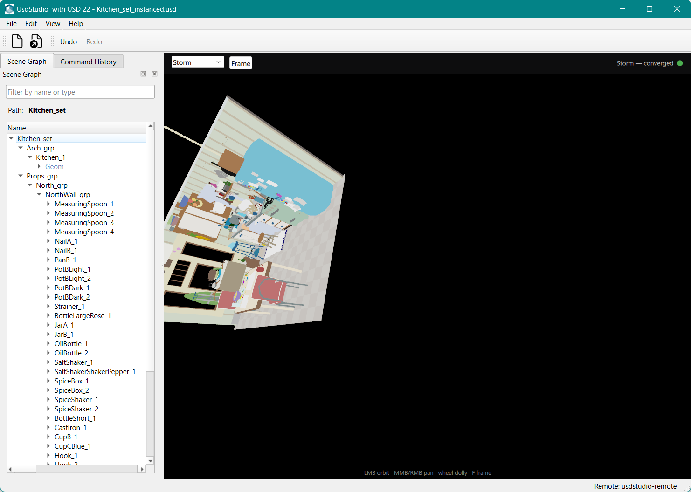

# UsdStudio

Pathfinder project for a integrated USD environment with Hydra 2 render delegate support in Qt Quick (QML)

## Build from Source

The Build is the tricke part in OpenUSD:

[Build](Build.md)